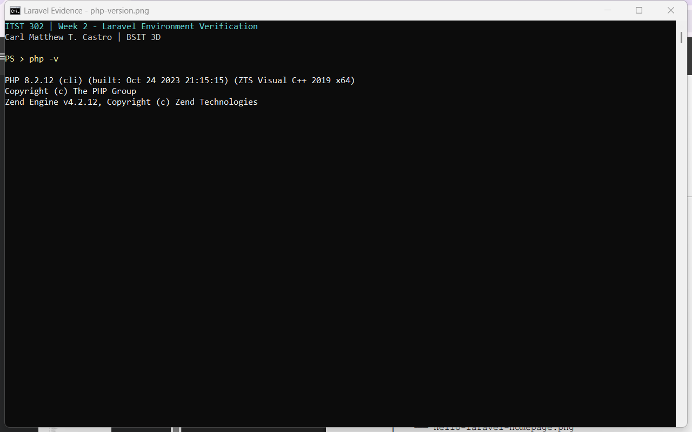
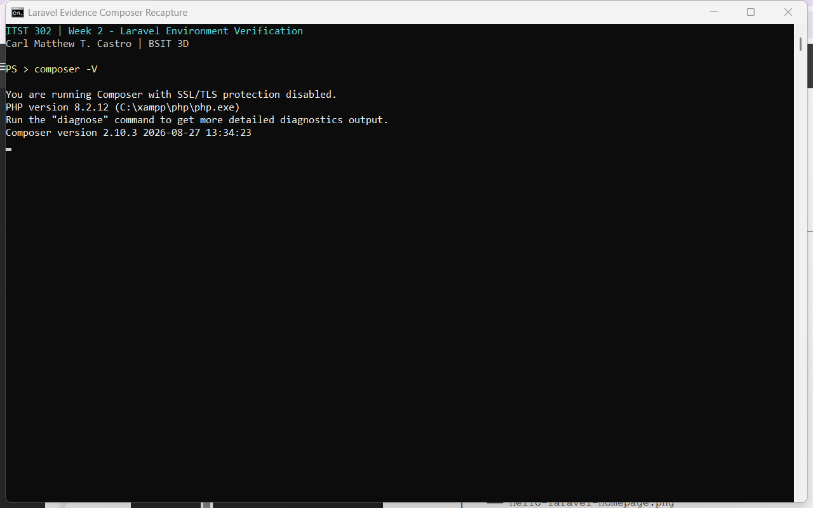
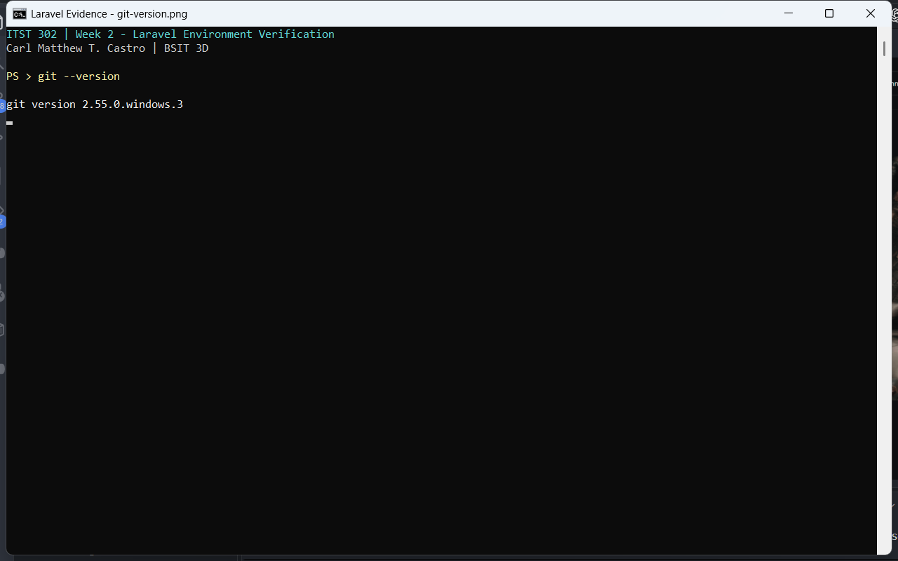
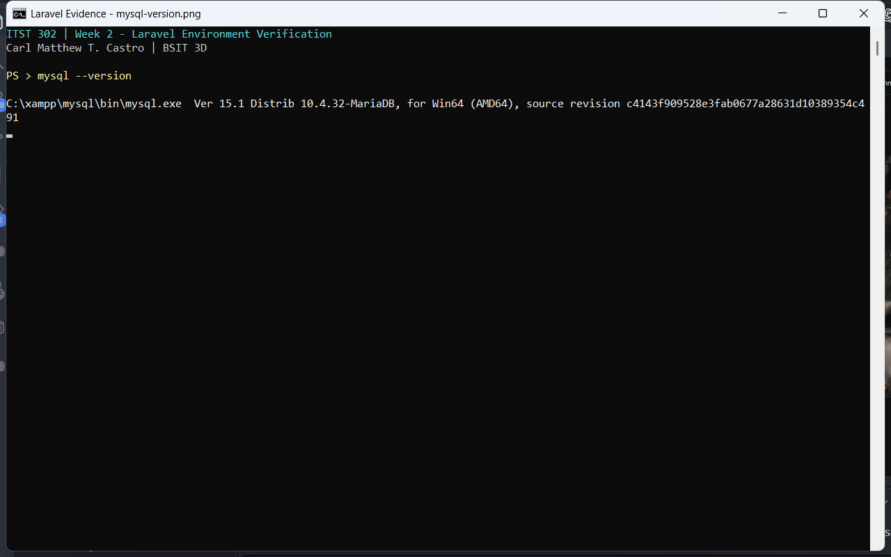
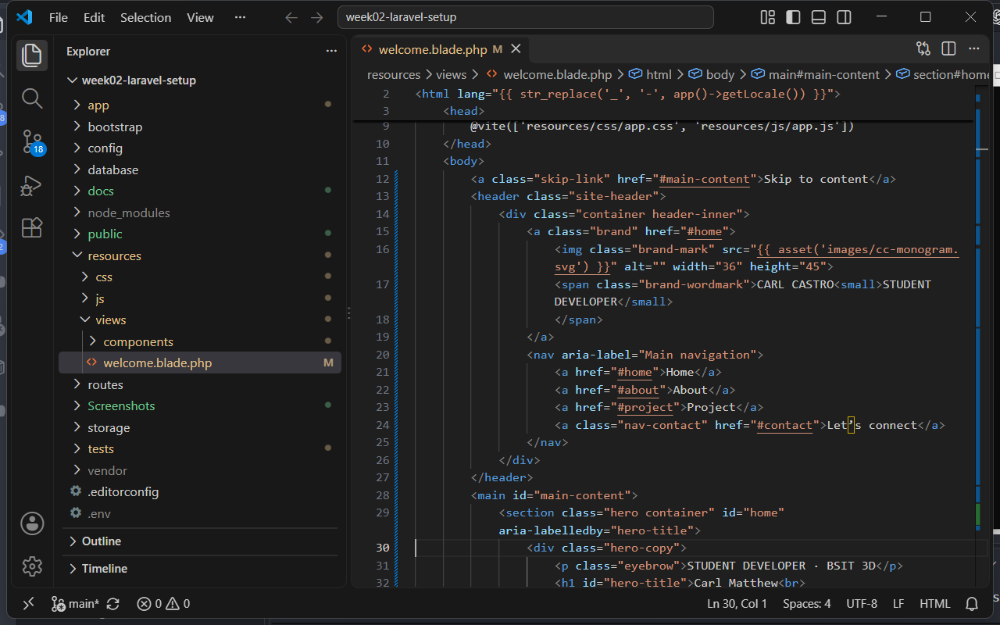
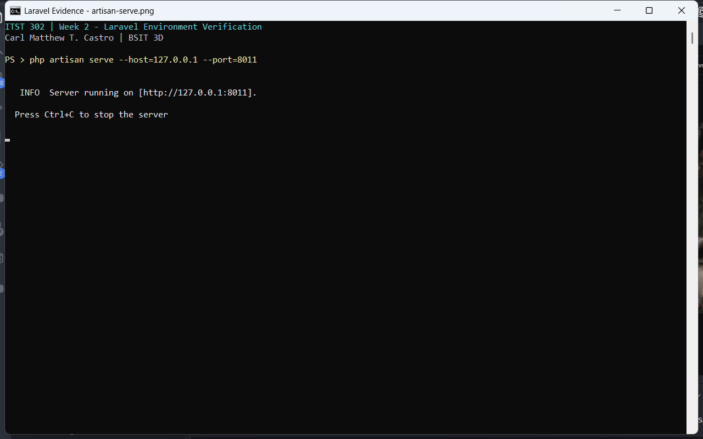
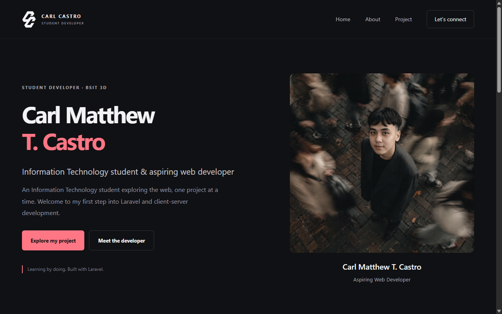
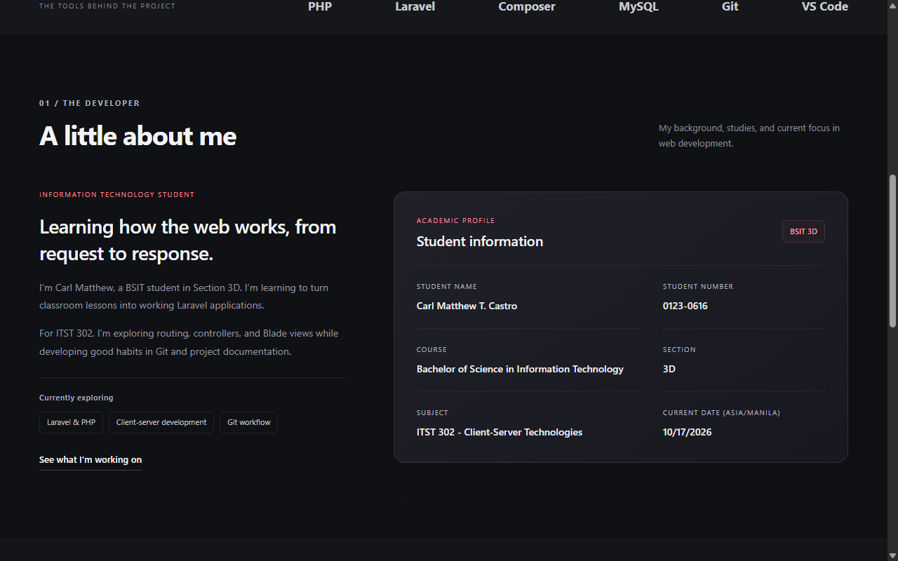

# 1. Project Title

**Client-Server Week 02: Laravel Development Environment Setup**

A Laravel student portfolio that demonstrates a working development environment, the client-server request lifecycle, and a customized homepage.

## 2. Introduction

### Brief Overview of Laravel

Laravel is a PHP framework for building web applications. It provides routing, controllers, Blade templates, the Eloquent object-relational mapper, and tools for database migrations. These features help developers organize application logic and create maintainable projects (Laravel, n.d.).

### Importance of Client-Server Technologies

In a web application, the browser acts as the client: it sends an HTTP request and displays the response. The server receives the request, executes application logic, and returns content. Understanding this relationship helps developers build applications that separate presentation, processing, and data storage (MDN contributors, 2026).

### Purpose of the Project

This activity establishes a Laravel development environment using PHP, Composer, Laravel, Git, MySQL/MariaDB, and Visual Studio Code. The application demonstrates routing through a controller to a Blade view. Its homepage presents the developer's profile, student information, project overview, and the current date in Philippine time. This README records the setup process, verification evidence, challenges, and solutions.

## 3. Objectives

The following objectives were achieved during the activity:

1. Set up the tools needed for local Laravel development.
2. Verify PHP, Composer, the Laravel installer, Git, and MySQL/MariaDB using version commands.
3. Create and run a Laravel application using `php artisan serve`.
4. Connect a browser route to a controller and render a Blade view.
5. Customize the homepage with the required greeting, student details, and current date.
6. Organize reusable Blade components and responsive frontend assets.
7. Maintain a Git history with at least five meaningful existing commits.
8. Document installation steps, screenshots, encountered problems, and solutions in Markdown.

## 4. Development Environment

| Component | Version / Details |
| --- | --- |
| Operating System | Microsoft Windows 11 Home Single Language, Build 26200 |
| PHP | 8.2.12 |
| Laravel Framework | 12.65.0 |
| Laravel Installer | 5.32.0 |
| Composer | 2.10.3 |
| Git | 2.55.0.windows.3 |
| MySQL / MariaDB | MariaDB 10.4.32 through XAMPP; command-line client reports Ver 15.1 |
| Visual Studio Code | 1.142.0 |
| Node.js | 22.20.0; used to build frontend assets with Vite |

Tool versions were verified locally. The operating-system details come from the original setup record. The Laravel installer version differs from the Laravel framework version installed in this project.

MySQL/MariaDB was installed and verified for the activity. The repository's default `.env.example` uses **SQLite**, so MySQL is optional when running this homepage with the default configuration.

## 5. Installation Steps

### Step 1 — Install and Verify PHP

Install PHP through XAMPP (Apache Friends, n.d.; The PHP Group, n.d.) and add `C:\xampp\php` to the Windows PATH. Open a new PowerShell terminal and run:

```powershell
php -v
```



*Figure 1. PHP 8.2.12 verified using `php -v`.*

### Step 2 — Install and Verify Composer

Following the Composer installation guide (Composer, n.d.), install Composer for Windows, selecting the PHP executable at `C:\xampp\php\php.exe` when prompted. Reopen the terminal and verify:

```powershell
composer -V
```



*Figure 2. Composer 2.10.3 verified using `composer -V`.*

### Step 3 — Install and Verify the Laravel Installer

Install the Laravel installer through Composer. Ensure Composer's global executable directory is included in PATH, then verify:

```powershell
composer global require laravel/installer
laravel -V
```


*Figure 3. Laravel Installer 5.32.0 verified using `laravel -V`.*

### Step 4 — Install and Verify Git

Install Git for Windows with its command-line tools available in PATH (Chacon & Straub, 2014). Verify:

```powershell
git --version
```



*Figure 4. Git 2.55.0.windows.3 verified using `git --version`.*

### Step 5 — Install and Verify MySQL/MariaDB

Install XAMPP and start its MySQL service from the XAMPP Control Panel. XAMPP provides MariaDB, a MySQL-compatible database server. Verify the installed client:

```powershell
& 'C:\xampp\mysql\bin\mysql.exe' --version
```

If that directory is already in PATH, use `mysql --version` instead. This command verifies the client version; it does not prove that the database service is running.



*Figure 5. The XAMPP database client reports MariaDB 10.4.32.*

### Step 6 — Install Visual Studio Code and Open the Project

Install Visual Studio Code with the **Add to PATH** option (Microsoft, n.d.). Open the project folder using **File → Open Folder**, or run this command from the project directory:

```powershell
code .
```



*Figure 6. The Laravel project and its homepage source open in Visual Studio Code.*

### Step 7 — Create a Laravel Project

For a new application, run:

```powershell
composer create-project laravel/laravel hello-laravel
cd hello-laravel
```

Alternatively, use `laravel new hello-laravel`. These commands create a new application; use the following instructions to run this existing customized repository.

### Step 8 — Configure and Run This Repository

Install Node.js 22.12 or later in the Node.js 22 series, then clone and open this repository:

```powershell
git clone https://github.com/carlmatthewcastro/client-server-week02-laravel-setup.git
cd client-server-week02-laravel-setup
composer install
```

For a fresh clone, create the local environment file and generate the application key:

```powershell
Copy-Item .env.example .env
php artisan key:generate
```

Keep the default SQLite connection and enable PHP's `pdo_sqlite` extension. Create the database file, run migrations, and build the assets:

```powershell
php -r "file_exists('database/database.sqlite') || touch('database/database.sqlite');"
php artisan migrate
npm ci
npm run build
php artisan serve
```

Open **http://127.0.0.1:8000** in a browser. Migrations create the tables needed by the default database-backed sessions and cache. The Vite asset build supplies the CSS and JavaScript referenced by the homepage (Vite, n.d.).

To use MySQL instead, create a database, set `DB_CONNECTION=mysql`, and configure `DB_HOST`, `DB_PORT`, `DB_DATABASE`, `DB_USERNAME`, and `DB_PASSWORD` in `.env` before running migrations.



*Figure 7. A running Artisan development server. This capture explicitly uses port 8011; the default port is 8000.*

### Step 9 — Customize and Verify the Homepage

The application uses the following files:

- `routes/web.php` maps `/` to `PortfolioController`.
- `app/Http/Controllers/PortfolioController.php` supplies student details and the current date in `Asia/Manila`.
- `resources/views/welcome.blade.php` renders the homepage and required greeting: **Hello Laravel! Welcome to Client-Server Technologies.**
- `resources/views/components/` contains reusable Blade components.
- `resources/css/app.css` and `resources/js/app.js` provide responsive styling and animations.

The About section displays the student's name, number, course, section, subject, and current date.

```powershell
php artisan test
npm run build
```



*Figure 8. Homepage overview with the developer introduction and profile photograph.*



*Figure 9. About section with learning focus and the required student information.*

### Step 10 — Track Changes and Publish to GitHub

For this existing Git repository, review and commit the intended changes, then push:

```powershell
git status
git add README.md app resources routes tests Screenshots docs
git commit -m "docs: update activity documentation and screenshots"
git push origin main
```

Use meaningful commit messages that describe the actual changes. Keep `.env` and dependency directories out of version control. Confirm that the repository is public before submitting its URL.

Repository: [client-server-week02-laravel-setup](https://github.com/carlmatthewcastro/client-server-week02-laravel-setup).

## 6. Project Structure

| Folder | Purpose in the Project |
| --- | --- |
| `app/` | Contains application logic, including `PortfolioController`, models, and service providers. |
| `routes/` | Defines application routes. `web.php` maps browser requests to the controller; this project does not include an API route file. |
| `resources/` | Stores Blade views, reusable components, source CSS, and JavaScript. |
| `public/` | Serves as the web document root and contains `index.php`, public images, and compiled frontend assets. |
| `config/` | Stores configuration for the application, database, sessions, cache, mail, and other services. |
| `database/` | Contains migrations, factories, seeders, and the local SQLite database when created. |
| `tests/` | Contains automated checks for the application, including homepage content and the Philippine date. |
| `Screenshots/` | Stores the nine verification images used in this README. |
| `docs/` | Contains the LinkedIn portfolio post draft. |

## 7. Problems Encountered

The original setup documentation records these installation challenges:

1. **Composer was not recognized.** Some terminal sessions could not locate the Composer command.
2. **PHP PATH pointed to the wrong executable.** The active terminal used an unintended PHP installation.
3. **MySQL/MariaDB did not start.** Database connection checks failed while the service was unavailable.
4. **The VS Code command was unavailable.** PowerShell did not recognize `code`.

## 8. Solutions

| Problem | Solution Applied |
| --- | --- |
| Composer command not recognized | Added Composer's executable directory to PATH and reopened the terminal. Verified the result with `composer -V`. |
| Incorrect PHP executable | Checked executable locations using `where.exe php` and updated PATH so `C:\xampp\php` took priority. Verified with `php -v`. |
| MySQL/MariaDB service unavailable | Restarted the service through XAMPP and checked the configured port and database credentials. For MySQL-backed Laravel connections, ensured `.env` matched the running server. |
| VS Code command not recognized | Enabled the installer's **Add to PATH** option and reopened PowerShell. Verified that `code .` opened the project. |

## 9. Screenshots

All nine screenshots use a consistent **1280 × 800 pixel** resolution. Version commands were freshly captured with matching terminal framing. The VS Code image shows the actual homepage source, and the two homepage images show the introduction and About section. Reduced motion was enabled for stable browser captures.

| Figure | Screenshot | Caption |
| --- | --- | --- |
| 1 | [php-version.png](Screenshots/php-version.png) | PHP 8.2.12 command-line verification. |
| 2 | [composer-version.png](Screenshots/composer-version.png) | Composer 2.10.3 command-line verification. |
| 3 | [laravel-version.png](Screenshots/laravel-version.png) | Laravel Installer 5.32.0 command-line verification. |
| 4 | [git-version.png](Screenshots/git-version.png) | Git 2.55.0.windows.3 command-line verification. |
| 5 | [mysql-version.png](Screenshots/mysql-version.png) | XAMPP MariaDB client version verification. |
| 6 | [vscode.png](Screenshots/vscode.png) | Laravel project folders and homepage source in VS Code. |
| 7 | [artisan-serve.png](Screenshots/artisan-serve.png) | Artisan development server running on port 8011. |
| 8 | [hello-laravel-homepage-1.png](Screenshots/hello-laravel-homepage-1.png) | Homepage introduction and developer profile. |
| 9 | [hello-laravel-homepage-2.png](Screenshots/hello-laravel-homepage-2.png) | About section, learning focus, and student details. |

## 10. Reflection

The completion of this activity strengthened my understanding of the relationship between development environment configuration and reliable web application development. Installing and verifying PHP, Composer, Laravel, Git, and MySQL/MariaDB demonstrated that application functionality depends on correctly configured tools. The distinction between the Laravel installer and the application framework also became clearer, emphasizing the importance of reporting software versions accurately rather than assuming that related tools share the same release number.

Developing the customized homepage provided a practical understanding of client-server communication. A browser request is matched to a route, processed through a controller, and returned as a rendered Blade view. Separating student information from presentation logic clarified the responsibilities of these application components. Reusable templates reduced duplication, while displaying the current date in Philippine time demonstrated the need to consider application context when presenting server-generated information.

The principal challenges concerned configuration rather than feature implementation. Unrecognized Composer commands, conflicting PHP executable paths, an unavailable MySQL service, and missing Visual Studio Code command-line integration initially interrupted the setup process. Resolving these issues required systematic examination of environment variables, executable locations, service availability, and configuration values. This experience reinforced the value of evidence-based troubleshooting: identifying the cause of an error before modifying application code. Documenting the corresponding solutions also created a reference for repeating the setup on another machine.

Laravel's relevance to client-server development became evident through its organized approach to routing, controllers, views, and database management. These conventions provide a consistent structure for coordinating server responsibilities and presenting responses to clients. Although this activity focused on environment preparation and a portfolio homepage, the framework's migration and data-access capabilities provide a foundation for later database features. Understanding that foundation is necessary before attempting more complex application requirements.

The activity further developed my appreciation of documentation, version control, and interface quality as essential development responsibilities. Meaningful commits made changes easier to trace, while captioned screenshots supported verification of the documented setup. Responsive layouts and reduced-motion support encouraged consideration of usability alongside functionality. These practices will inform future coursework and the planned Laravel e-commerce project by supporting reproducible setup, clearer collaboration, and more maintainable implementation. Overall, the activity established a practical basis for approaching subsequent development tasks with greater technical discipline and confidence.

## 11. References

Apache Friends. (n.d.). *XAMPP FAQs for Windows*. https://www.apachefriends.org/faq_windows.html

Chacon, S., & Straub, B. (2014). *Pro Git* (2nd ed.). Apress. https://git-scm.com/book/en/v2

Composer. (n.d.). *Introduction*. https://getcomposer.org/doc/00-intro.md

Laravel. (n.d.). *Installation*. Laravel 12.x documentation. https://laravel.com/docs/12.x

MDN contributors. (2026, October 8). *Overview of HTTP*. MDN Web Docs. https://developer.mozilla.org/en-US/docs/Web/HTTP/Guides/Overview

Microsoft. (n.d.). *Installing Visual Studio Code on Windows*. Visual Studio Code. https://code.visualstudio.com/docs/setup/windows

The PHP Group. (n.d.). *PHP manual*. https://www.php.net/manual/en/

Vite. (n.d.). *Getting started*. https://vite.dev/guide/
